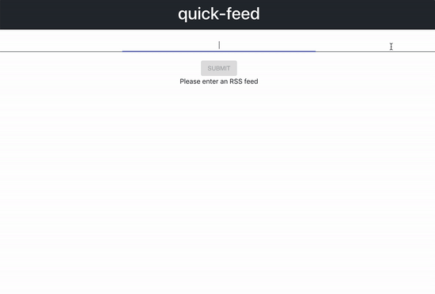
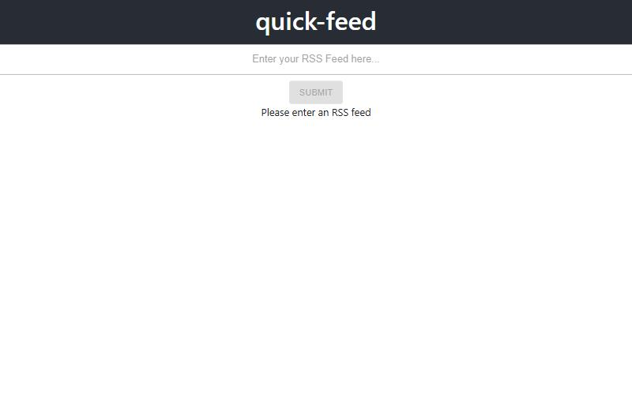
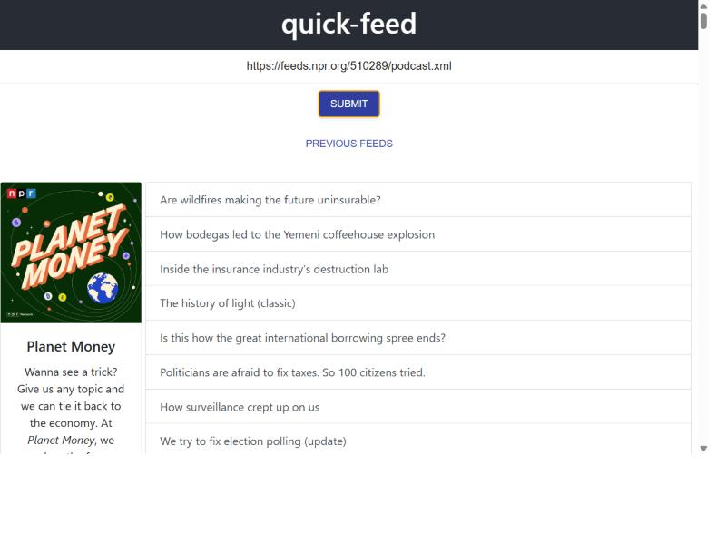
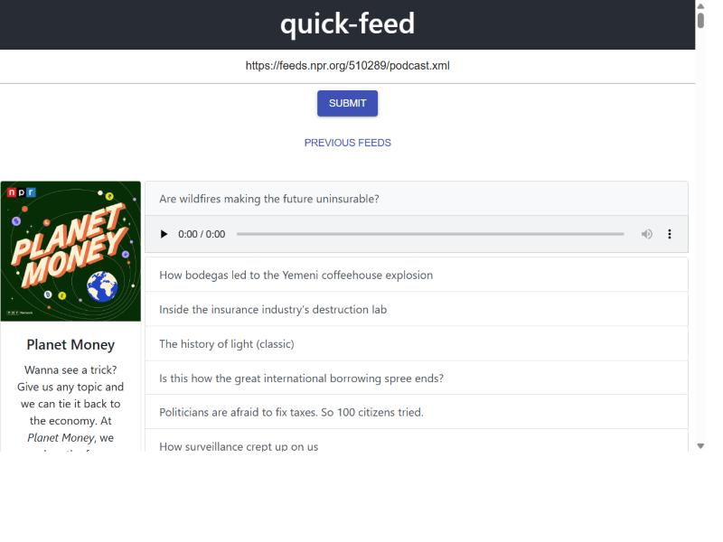

# quick-feed

This project is a simple ReactJS app for rendering RSS feeds for podcasts.
You can try out the app [here](https://amcquade.github.io/quick-feed/).

###### This project was bootstrapped with [Create React App](https://github.com/facebook/create-react-app). You can read more about it [here](learnMoreReact.md).

## Usage

> **Note:** feeds are fetched through the public `cors-anywhere.herokuapp.com` proxy, which now requires manual opt-in and rejects requests, so loading a feed currently fails with an "Error Parsing Feed" dialog until the proxy is replaced (see #43). The screenshots below were taken with a local pass-through proxy.

1. Paste the URL of a podcast RSS feed into the input and press **Submit**.

   

2. The podcast artwork, title, description and episode list are loaded.

   

3. Click an episode title to expand it and play the audio with the built-in player.

   

Feeds you have loaded are listed under **Previous Feeds** so you can reload them with one click.

## Available Scripts

In the project directory, you can run:

### `npm start`

Runs the app in the development mode. 
Open [http://localhost:3000](http://localhost:3000) to view it in the browser.

The page will reload if you make edits. 
You will also see any lint errors in the console.

### `npm test`

Launches the test runner in the interactive watch mode. 
See the section about [running tests](https://facebook.github.io/create-react-app/docs/running-tests) for more information.

### `npm run build`

Builds the app for production to the `build` folder. 
It correctly bundles React in production mode and optimizes the build for the best performance.

The build is minified and the filenames include the hashes. 
Your app is ready to be deployed!

See the section about [deployment](https://facebook.github.io/create-react-app/docs/deployment) for more information.
